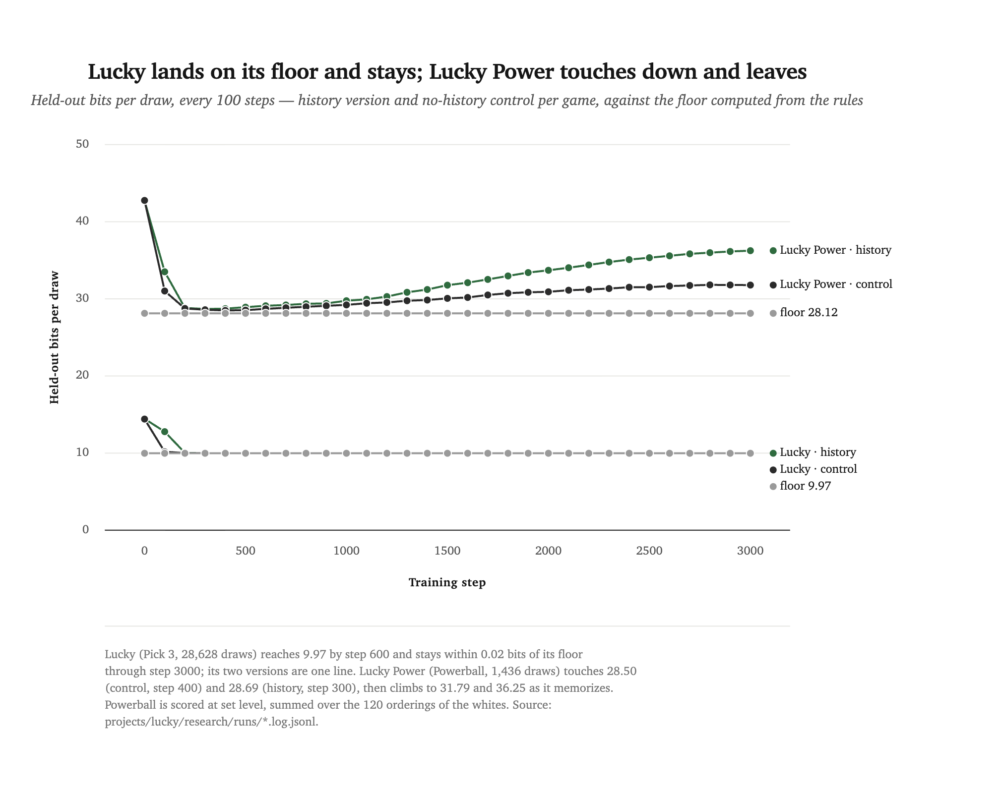

# Model Card — `lucky-nanogpt-1` (v1, Lucky)

A small GPT trained on every Maryland Pick 3 draw since 1976, which reads the
last 8 draws and picks the next one. Its held-out loss is 9.9709 bits per
draw. The best any model can do is log₂ 1,000 = 9.9658, a number known before
training from the rules of the game.

It is one half of a null experiment: the full write-up is
[What does a model learn from fifty years of lottery draws?](../reports/fifty-years-of-lottery-draws.md)
Its sibling on a bigger ticket is
[`lucky-nanogpt-power-1`](lucky-nanogpt-power-1.md).

## Model details

| | |
|---|---|
| **Version / git tag** | `lucky-nanogpt-1` (research run `lucky-history`) |
| **Architecture** | modern (RoPE, RMSNorm, bias-free) from the shared `core` engine, trained by the project's own draw-boundary loop |
| **Size** | 4 layers · 4 heads · 128 embedding dim · 36 context · no dropout · 0.79M params |
| **Tokenizer** | one token per digit: `0`–`9` and newline, 11 tokens. A draw is 4 tokens |
| **Context** | 9 draws: the last 8 real draws, then the one being picked |
| **Checkpoint** | `projects/lucky/models/lucky-nanogpt-1/` (weights not committed) |
| **Developed with** | Claude ([Claude Code](https://claude.com/claude-code)) |
| **License** | MIT |

## Intended use

An exhibit of what no signal looks like. Give it eight draws and it continues
the list with a ninth, sampled at temperature 1 from a seed, so the same
tape and seed always give the same pick. `harness.py pick` does this from the
last eight draws in the corpus and can roll forward, feeding each pick back
in as history.

**Out of scope.** It does not predict the lottery, and it measures that it
cannot: every ticket it prints is a 1 in 1,000 shot, the same as any other.
It is specific to a three-digit game and knows nothing about Pick 4 or
Pick 5.

## Training data

28,628 Maryland Pick 3 draws: 17,592 evening draws from 29 Jul 1976 and
11,036 midday draws from 1 May 1995, through 23 Nov 2026. Draw machines made
this corpus, and no model or script wrote any of it.

The draws come from the Maryland Lottery's own winning-numbers search and
were cross-checked against LotteryCorner's archive: 28,603 agree, 18 differ
(the official value is kept), 7 are in the official archive only, and 73 that
only the second source lists are left out. The record is
`projects/lucky/models/lucky-nanogpt-1/provenance.json`.

Before training, 44 chi-square tests on these draws (digit frequency by
position, era and decade; all 1,000 combinations; dependence between
consecutive draws) found nothing that rejects uniformity. The split is by
time: draws to 22 Jan 2019 train, the next 2,862 pick the stopping step, and
the most recent 2,862 (to 23 Nov 2026) are held out.

## Training procedure

- **Examples:** cut at draw boundaries as "8 draws → next draw", with the
  loss on the final draw only.
- **Optimizer:** AdamW, LR 3e-4 with cosine decay to 3e-5, 100 warmup steps,
  β₂ 0.99, weight decay 0.1, batch size 256.
- **Run:** 3,000 steps (33 epochs) from seed 1337. The release is the step
  with the lowest validation loss, step 1100.
- **Hardware:** Apple Silicon Mac, CPU.

## Evaluation

| Metric | Result |
|---|---|
| **Held-out loss** | 9.9709 bits/draw over 2,862 draws, 95% interval [9.9675, 9.9745] |
| **Floor** | 9.9658 bits/draw |
| **Above the floor** | +0.0051 bits (0.05%) |
| **No-history control** | 9.9707 bits/draw |
| **Control minus history** | −0.0002 bits/draw, 95% interval [−0.0052, +0.0046] |
| **At step 3000** | 9.9844 bits/draw |
| **Valid picks, raw** | 99,994 of 100,000 samples are three digits |

The control is the same model trained on the same targets with nothing to
read. If the last eight draws said anything about the ninth, the history
version would score lower. The two differ by two ten-thousandths of a bit,
inside an interval that straddles zero.

<picture>
  <source media="(prefers-color-scheme: dark)" srcset="../reports/assets/exp17-loss-vs-floor.dark.png">
  
</picture>

## Limitations

- **It has learned one thing: the shape of a draw.** Three digits and a
  newline. Everything else it could have learned is noise, and by step 3000
  it has started to: held-out loss rises from 9.9709 to 9.9844 as it fits
  quirks of the training draws.
- **The tape is decoration.** That is the finding, and it shows in the
  picks: swap the eight draws for a different eight, keep the seed, and 1,985
  of 2,000 picks come out identical. The seed chooses the ticket.
- **0.005 bits above the floor is not zero.** It is the price of estimating
  ten digit frequencies from a finite sample. No amount of training removes
  it; more draws would.
- **6 raw samples in 100,000 are not three digits** (a newline lands in a
  digit slot). The harness rejects those and samples again from the next
  seed.
- **No weights in the tree** ([ADR-0002](../../docs/adr/0002-no-weights-in-tree.md)).

## How to reproduce

```bash
cd projects/lucky/models/lucky-nanogpt-1
python prepare.py        # -> draws.bin + meta.pkl
python train.py          # -> ckpt.pt (step 1100), ckpt_final.pt, log.jsonl
python eval.py           # 9.9709 bits/draw, +0.0051 from the floor
python harness.py pick
```

## Citation / credits

- The shared `core` engine (modern nanoGPT lineage: RoPE, RMSNorm, bias-free).
- The Maryland Lottery, whose published results are the corpus, and
  LotteryCorner, whose archive is the cross-check.
- Set up and trained with Claude ([Claude Code](https://claude.com/claude-code)).
