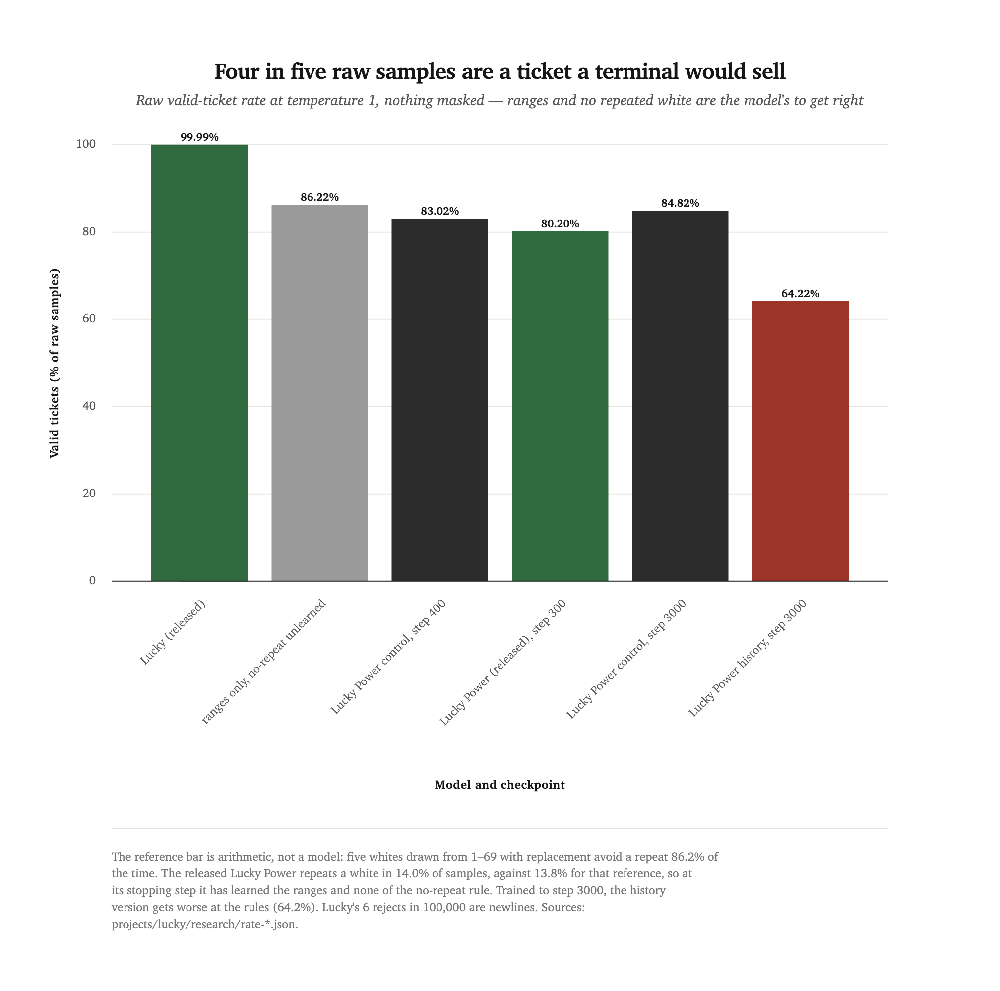

# Model Card — `lucky-nanogpt-power-1` (v1, Lucky Power)

A small GPT trained on every Powerball draw under the current rules, which
reads the last 8 draws and picks five whites and a red. Its held-out loss is
28.687 bits per draw against a floor of log₂ 292,201,338 = 28.122. It gets
within 0.56 bits of the floor and no closer: 1,436 draws run out before it
has learned the rule that a white cannot repeat.

It is one half of a null experiment: the full write-up is
[What does a model learn from fifty years of lottery draws?](../reports/fifty-years-of-lottery-draws.md)
Its sibling on a smaller ticket is [`lucky-nanogpt-1`](lucky-nanogpt-1.md).

## Model details

| | |
|---|---|
| **Version / git tag** | `lucky-nanogpt-power-1` (research run `power-history`) |
| **Architecture** | modern (RoPE, RMSNorm, bias-free) from the shared `core` engine, trained by the project's own draw-boundary loop |
| **Size** | 4 layers · 4 heads · 128 embedding dim · 72 context · no dropout · 0.80M params |
| **Tokenizer** | one token per number: `1`–`69` (shared by whites and red), a separator bar, newline, 71 tokens. A draw is 8 tokens |
| **Context** | 9 draws: the last 8 real draws, then the one being picked |
| **Checkpoint** | `projects/lucky/models/lucky-nanogpt-power-1/` (weights not committed) |
| **Developed with** | Claude ([Claude Code](https://claude.com/claude-code)) |
| **License** | MIT |

## Intended use

An exhibit of what no signal looks like, on a game with rules to learn. The
model's job is to emit numbers. `harness.py` owns the ticket's form: it asks
for exactly five whites, writes the separator, asks for one red, and sorts
the whites. It never masks a number. Sampling is temperature 1 from a seed;
an attempt with an out-of-range number or a repeated white is a reject, and
the ticket is the first valid attempt, with attempt *n* drawn from seed + *n*.
The rejects are printed before it.

**Out of scope.** It does not predict Powerball: every valid ticket it prints
is a 1 in 292,201,338 shot, the same as any other. It knows the 69/26 matrix
only, so a rule change retires it. Power Play and Double Play are not in the
corpus.

## Training data

1,436 Powerball draws, every one under the 69/26 matrix, from 7 Oct 2015 to
21 Nov 2026. Draw machines made this corpus, and no model or script wrote
any of it.

The draws come from New York's open-data file and were cross-checked against
the Texas Lottery's file. All 1,436 agree as sets (New York sorts the whites,
Texas keeps draw order). The record is
`projects/lucky/models/lucky-nanogpt-power-1/provenance.json`.

Published results are sorted, and a model trained on sorted whites learns
that the first is usually small. So the loader writes each draw's five
whites in a fresh random order every epoch, and every white slot means what
it means in the drum: any unused number from 1 to 69.

The split is by time: 1,150 draws to 22 Jan 2025 train, the next 143 pick the
stopping step, and the most recent 143 (to 21 Nov 2026) are held out.

## Training procedure

- **Examples:** cut at draw boundaries as "8 draws → next draw", with the
  loss on the final draw only.
- **Optimizer:** AdamW, LR 3e-4 with cosine decay to 3e-5, 100 warmup steps,
  β₂ 0.99, weight decay 0.1, batch size 64.
- **Run:** 3,000 steps (167 epochs) from seed 1337. The release is the step
  with the lowest validation loss, step 300, which is 17 epochs in.
- **Hardware:** Apple Silicon Mac, CPU.

## Evaluation

Loss is scored at set level: the model's probability summed over all 120
orderings of a held-out draw's whites, so the number compares to the floor
for a set of five, not a sequence of five.

| Metric | Result |
|---|---|
| **Held-out loss** | 28.687 bits/draw over 143 draws, 95% interval [28.594, 28.778] |
| **Floor** | 28.122 bits/draw |
| **Above the floor** | +0.564 bits (2.0%) |
| **No-history control** | 28.505 bits/draw |
| **Control minus history** | −0.182 bits/draw, 95% interval [−0.243, −0.120] |
| **At step 3000** | 36.251 bits/draw |
| **Valid tickets, raw** | 802,007 of 1,000,000 samples (80.2%) |
| **Samples matching a past draw** | 1 of 802,007, against 3.9 expected by chance |

<picture>
  <source media="(prefers-color-scheme: dark)" srcset="../reports/assets/exp17-valid-ticket-rate.dark.png">
  
</picture>

Of the 197,993 rejects, 140,083 repeat a white, 61,829 put the red outside
1–26, and 5,048 put a separator or newline in a white slot (a reject can
break more than one rule).

## Limitations

- **It has not learned the no-repeat rule.** It repeats a white in 14.0% of
  raw samples. Five numbers drawn from 1–69 with replacement repeat 13.8% of
  the time, so at its stopping step the rule is absent, not weak. The harness
  covers for it by resampling.
- **The red range is mostly learned.** 6.2% of raw samples put the red above
  26; a model with no idea would do so 62% of the time.
- **History made it worse.** The control with nothing to read scores 0.182
  bits better, and the interval excludes zero. One reading: the tape cannot
  inform the pick, so all it adds is 64 tokens to fit noise against.
- **Early stopping is the release.** Left to train, the same run reaches
  36.25 bits/draw held out and its valid-ticket rate falls to 64.2%. The
  curve that touches the floor is the one up to step 300.
- **143 held-out draws is a small test.** The interval on the loss is ±0.09
  bits, and it covers which draws were held out, not a different training
  seed.
- **The tape moves the pick less than the seed does.** Swap the eight draws
  for a different eight, keep the seed, and 1,164 of 2,000 picks come out
  identical.
- **No weights in the tree** ([ADR-0002](../../docs/adr/0002-no-weights-in-tree.md)).

## How to reproduce

```bash
cd projects/lucky/models/lucky-nanogpt-power-1
python prepare.py                    # -> draws.bin + meta.pkl
python train.py                      # -> ckpt.pt (step 300), ckpt_final.pt, log.jsonl
python eval.py                       # 28.6868 bits/draw, +0.5644 from the floor
python harness.py pick               # rejects print first, then the ticket
python harness.py rate --n 1000000   # the valid-ticket rate and the memorization check
```

## Citation / credits

- The shared `core` engine (modern nanoGPT lineage: RoPE, RMSNorm, bias-free).
- The Multi-State Lottery Association, whose draws are the corpus, by way of
  New York's open-data portal and the Texas Lottery's published file.
- Set up and trained with Claude ([Claude Code](https://claude.com/claude-code)).
