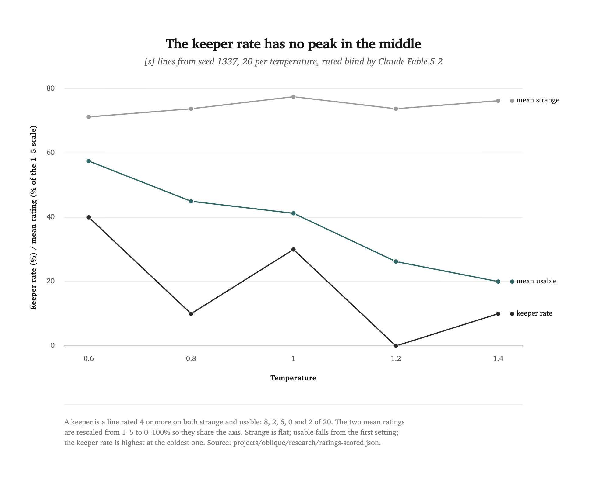

# Model Card — `oblique-nanogpt-1` (v1)

A character-level GPT that deals one-line aphorisms in two registers. Behind
`[s]` it writes a sideways instruction to a stuck artist. Behind `[f]` it
writes a fortune. It was built to find the sampler setting where its lines
are strange and usable at once, and the experiment found no such setting:
see [Is oblique a temperature?](../reports/is-oblique-a-temperature.md)

The name is the quality the project measured. *Oblique Strategies* is Brian
Eno and Peter Schmidt's deck. The model is in its spirit and uses none of its
cards.

## Model details

| | |
|---|---|
| **Version / git tag** | `oblique-nanogpt-1` (research run `seed1337`, step 12,000) |
| **Architecture** | modern char-level (RoPE, RMSNorm, bias-free) on the shared `core` engine |
| **Size** | 4 layers · 4 heads · 128 embedding dim · 128 context · dropout 0.2 · 797,312 params |
| **Tokenizer** | character-level, 38 symbols: lowercase letters, space, newline, the two token brackets and `.,'?!;:-` |
| **Control token** | `[s] ` for a strategy, `[f] ` for a fortune, at the start of every line |
| **Checkpoint** | `projects/oblique/models/oblique-nanogpt-1/` (weights not committed) |
| **Built on** | the monorepo's shared [`core`](../../core/) engine |
| **License** | MIT |

## Intended use

An exhibit. Prime it with a newline and a register token, sample to the next
newline, and read one line. The dial is set to temperature 0.6, where the
share of lines a blind rater scored 4 or more on both *strange* and *usable*
was highest: 8 of 20. That setting is the best of five noisy ones, not a
peak. The same rate was 2 of 20 one step warmer and 6 of 20 one step past
that.

**Out of scope.** It gives no advice and knows nothing. A line that reads as
guidance is an accident of a 0.79M-parameter model recombining 30,000
synthetic lines. The fortune register in particular is unreliable: its lines
often break mid-sentence.

## Training data

30,000 lines, 15,000 per register, 1.53M characters, written by four LLMs
through `tools/synthgen` on OpenRouter for $0.36:
`anthropic/claude-haiku-5.5`, `openai/gpt-6-luna`,
`deepseek/deepseek-v4.1-flash` and `meta/muse-ember`.

- **Prompts describe the shape and show no example.** A strategy is "a short
  instruction to a stuck artist that approaches the problem from the side;
  never advice, never a platitude; under twelve words." A fortune is "a
  one-line fortune, sincere, second person, under twelve words, no proper
  nouns."
- **Filter.** 2 to 11 words, 8 to 80 characters, no proper nouns, exact and
  near duplicates removed (normalized edit similarity 0.85 or above), the
  corpus lowercased, both registers cut to 15,000 lines. 47,848 raw lines
  went in.
- **No card from the deck.** 42,705 lines were checked against 247 published
  *Oblique Strategies* cards. 0 matched, exactly or nearly. The closest
  surviving line sits at 0.789 similarity.
- **The record is committed**: every raw response, the synthgen manifest
  with per-response cost, and the filter log, in `projects/oblique/data/`.
  The corpus is pinned in the frozen folder as `corpus.txt`.

## Training procedure

- **Optimizer:** AdamW, LR 1e-3 with cosine decay to 1e-4, 100 warmup steps, β₂ 0.99, batch size 64, dropout 0.2.
- **Run:** 12,000 steps, seed 1337, about 70 passes over the training split. Validation loss 0.7689, train loss 0.7238, still falling at the last eval.
- **Split:** 90/10 by whole line.
- **Hardware:** Apple Silicon Mac (MPS), `torch.compile` disabled, about 75 ms a step.

## Evaluation

**Automatic**, 500 samples per register per cell, soft-cap off:

| Temperature | Exact copies | 8-gram overlap | Well-formed | Over length only | Register recovered |
|---|---|---|---|---|---|
| 0.6 | 0.1% | 91.6% | 86.7% | 13.2% | 98.7% |
| 0.8 | 0.0% | 87.5% | 89.1% | 10.8% | 97.5% |
| 1.0 | 0.0% | 80.7% | 90.0% | 8.9% | 96.5% |
| 1.2 | 0.0% | 73.0% | 87.2% | 7.2% | 94.0% |
| 1.4 | 0.0% | 64.1% | 83.0% | 5.8% | 90.8% |

Held-out corpus lines score 88.0% on 8-gram overlap, so the model at
temperature 0.8 and above shares no more with its training set than unseen
text does. "Register recovered" is a word-level logistic regression trained
on the corpus guessing which token produced each sample; it scores 98.3% on
held-out corpus lines.

**Rated**, blind, by Claude Fable 5.2 (not a human): 20 lines per register
per temperature, each scored 1 to 5 on *strange* and *usable*.

| Temperature | `[s]` keepers of 20 | `[s]` mean strange | `[s]` mean usable | `[f]` keepers of 20 |
|---|---|---|---|---|
| 0.6 | 8 | 3.85 | 3.30 | 0 |
| 0.8 | 2 | 3.95 | 2.80 | 0 |
| 1.0 | 6 | 4.10 | 2.65 | 0 |
| 1.2 | 0 | 3.95 | 2.05 | 0 |
| 1.4 | 2 | 4.05 | 1.80 | 0 |

<picture>
  <source media="(prefers-color-scheme: dark)" srcset="../reports/assets/exp18-keeper-rate.dark.png">
  
</picture>

In the blind register test the same rater named the token behind 52 of 60
lines.

Samples at temperature 0.6, raw and unpicked (`sample.py --seed 18`):

```
[s] let one corner carry the main stranger.
[s] use the familiar colour for the entire version of paper.
[s] what would the room look like at the room?
[s] wait until the first color feels alive.
[s] trade your favourite tool for a while.
[s] let the paper decide where the floor resembles.

[f] your tears are worth the table you keep holding.
[f] your hands know more than a future you speak.
[f] soon, your calm is already knowing the answer.
[f] a small kindness will return to you in a hour.
```

## Limitations

- **The dial setting is not a finding.** 0.6 had the most keepers on one
  sheet of 20 lines. A second seed, rated on 10 lines a cell, had more at 0.8
  than at 0.6.
- **The ratings are a model's.** The human rating the project was designed
  around has not been done.
- **About a tenth of lines run long.** The corpus stops at eleven words and
  the model does not count them, so 8.9% to 13.2% of lines at temperature 1.0
  and below reach twelve or thirteen.
- **It missed its own release bar.** The checkpoint rule registered before
  training asked for 90% well-formed lines at temperature 1.0 and below. This
  checkpoint scores 88.6%, and was accepted as a fallback.
- **Fortunes break.** No `[f]` line on the rated sheet was a keeper, and
  their mean usable rating never passed 2.30.
- **Lowercase only**, and no proper nouns, by construction.
- **The soft-cap is not a control.** Capping logits changes nothing down to a
  cap of 12 and destroys the output by 4.

## How to reproduce

```bash
cd projects/oblique/models/oblique-nanogpt-1
python prepare.py                 # corpus.txt -> oblique/{train,val}.bin + meta.pkl
python train.py config.py         # 12,000 steps, about 15 minutes on an M-series GPU
python sample.py                  # ten strategies at temperature 0.6
python sample.py --register f --n 5
python harness.py --caps none --out harness.json
```

## Citation / credits

- Designed by Romello Goodman; built with Claude
  ([Claude Code](https://claude.com/claude-code)).
- Corpus written by Claude Haiku 5.5, GPT-6 Luna, DeepSeek V4.1 Flash and
  Muse Ember, served by OpenRouter.
- Brian Eno and Peter Schmidt, *Oblique Strategies* (1975): the idea of a
  card that comes at a problem from the side. None of their cards is used.
- The shared [`core`](../../core/) engine (modern nanoGPT lineage).
