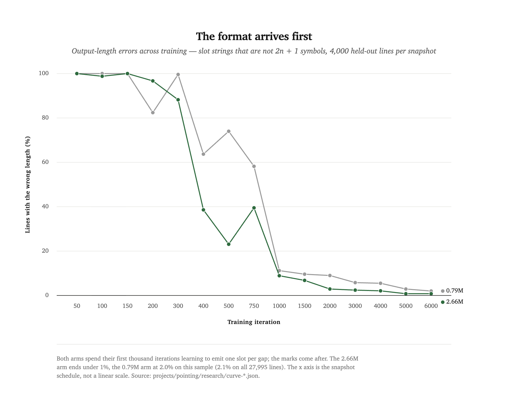
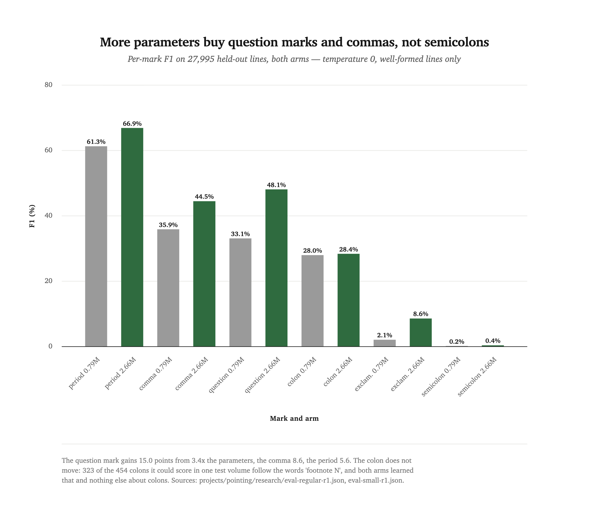
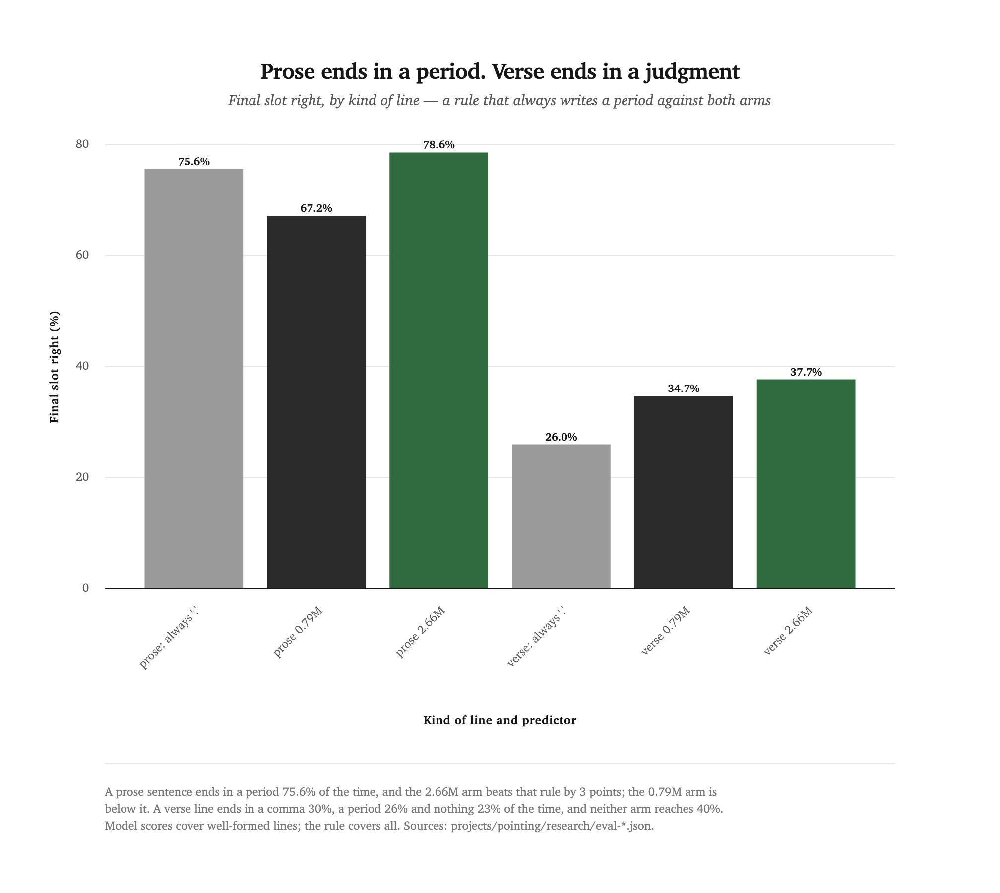
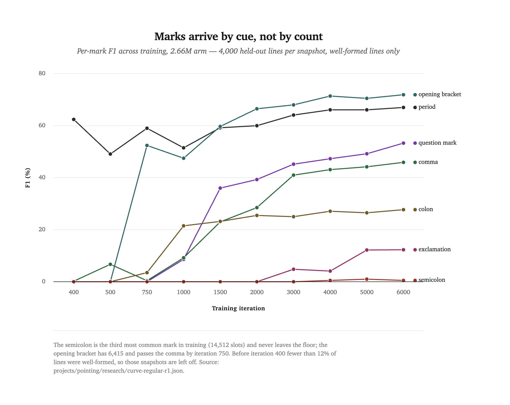
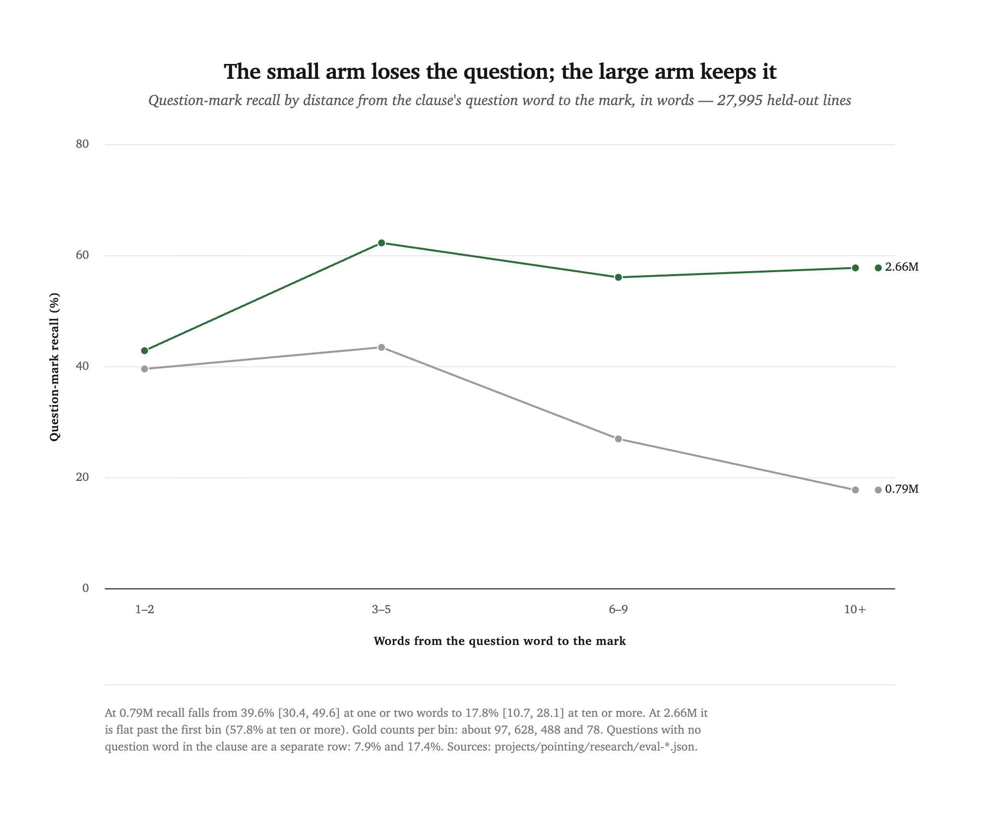

# Can a small model punctuate a line it has never seen?

Strip the punctuation from a line of Shakespeare, hand the bare words to a
2.66M-parameter model, and ask for the marks back. On 27,995 lines from
plays it never saw, it returns exactly the edition's punctuation 32.5% of
the time, and a rule that writes no marks and then a period gets 24.7%.

This is the studio's first model scored by its own corpus. daydream is
judged by a chess engine and pona by a grammar checker. pointing has a
ground truth printed on the page: strip a human line, ask the model to put
the marks back, and diff. One caveat caps every number below. The marks in
these plays are an editor's, not the playwright's, and two editors would
not agree with each other.

Four predictions and three kill criteria were committed before the first
training run. Most of the predictions failed, and the ways they failed are
the report.

## The model never copies a word

The obvious format is input, separator, output: the model reads the bare
line and writes it out again with marks. For a character-level model of this
size that is a long copy, and small models garble long copies.

So the model writes only the marks. A line of n words has n + 1 gaps: one
before the first word, one between each pair, one after the last. After the
separator it emits the first gap's slot, then for each word its first letter
and the slot for the gap that follows. A slot is `_` for nothing or a single
mark.

```
the quick brown fox jumps over the lazy dog|_t_q_b_f_j_o_t_l_d.
o that this too too solid flesh would melt|_o,t_t_t_t_s_f_w_m,
enter hamlet|[e_h.
```

The first letters are **anchors**. With bare slots the model has to count to
know which slot belongs to which word, and small character models count
badly. With anchors it matches a letter. The output is 2n + 1 symbols, and a
wrong answer is a wrong mark or a wrong anchor, never a mangled word.

The third example shows the format's one lossy rule. `[Enter Hamlet.]` ends
with two marks in one gap, a slot holds one, and the slot keeps the first.
4.8% of the corpus's marked gaps hold two or more marks. On the test works
that rule drops 83% of closing quotes, 77% of dashes and 53% of closing
brackets before the model ever sees a label. Every score here is against the
one-mark gold.

Everything is lowercased. An apostrophe or hyphen with a letter on both
sides is a letter, so `don't` and `well-met` stay whole words. Sixteen marks
are labels, and quotes carry the side they attach to, because one gap can
hold a closing quote or an opening one.

## A corpus borrowed from next door

The corpus is the shakespeare project's: the Complete Works plus twelve
Project Gutenberg volumes of Marlowe, Jonson, Kyd, Webster and Dekker, the
text that trained `shakespeare-nanogpt-3`. It is the one human corpus in the
tree where punctuation does real work, and it is the first time one project
here has trained on another's data.

Three things had to be built that the brief assumed were there.

**Works.** The corpus is one long text, and a split by whole work needs
works. The Complete Works cuts into 44 plays and poems at the headings its
own contents page names. Each other volume counts as one work, editor's
introduction and footnotes included. 56 works: 44 train, 3 watch the loss, 9
are held out. The nine were picked by hand before any model existed: five
from the Complete Works, one more Marlowe from an editor who also trains
(Dyce), and three volumes whose edition appears nowhere in training.

**Sentences.** The brief's unit was "verse lines and prose sentences, split
on newlines as the corpus already is." The corpus hard-wraps prose at about
70 columns, so a prose newline is a line break, not a sentence end. Wrapped
paragraphs are reflowed and cut after a terminal mark. That gives 117,781
verse lines, 20,056 prose sentences, and 69,138 units of a third kind:
speaker labels, headings and one-line speeches.

**A shuffle.** In play order, a training line sits next to the lines around
it and can lean on them. A test line arrives alone. Training lines are
shuffled so a line's neighbours are strangers in both.

0.77% of units were too long for a 256-character block and were dropped.
Two arms trained on the result with one recipe, 6,000 iterations each:
2.66M parameters (6 layers, 6 heads, 192 wide) and 0.79M (4, 4, 128).

## The format arrives first

Both arms learn to write a well-formed slot string before they learn where
most marks go. Follow the lines down: for the first few hundred
iterations nearly every output is the wrong length, and by iteration 1,000
about one in ten is.

<picture>
  <source media="(prefers-color-scheme: dark)" srcset="assets/exp16-format-errors-across-training.dark.png">
  
</picture>

On all 27,995 held-out lines the 2.66M arm writes the wrong number of slots
on 0.84% and a wrong anchor on 0.71%. The 0.79M arm does so on 2.14% and
2.04%. Prediction P4 said under 1% on both arms, and it failed on the small
one. The kill line was 5%, and neither arm is near it.

The small arm's errors are mostly overruns: 449 of its 598 bad lengths are
too long. It loses its place and keeps going. The format works at 2.66M and
strains at 0.79M.

## A third of the lines, eight points over a rule

| | rule: no marks, then a period | 0.79M | 2.66M |
|---|---|---|---|
| lines exactly right | 24.7% | 28.5% | **32.5%** |
| verse lines | 13.7% | 16.4% | 20.0% |
| prose sentences | 20.7% | 21.0% | 30.2% |
| labels, headings, one-line speeches | 56.2% | 63.7% | 67.7% |
| lines whose words never appear in training | — | 24.1% | 28.2% |
| slots right | 80.6% | 83.0% | 85.0% |
| all marks, precision / recall | — | 52.6% / 39.1% | 57.1% / 47.7% |

The rule is the bar that matters. Four slots in five are empty, and a
quarter of all lines are a speaker label, a heading or a one-line speech, so
a model can look
competent without knowing anything. Against that bar the 2.66M arm is ahead
on every kind of line, by 6 to 11 points. The 0.79M arm barely clears it on
prose.

You are about to ask why the studio is releasing a model that beats a
one-line rule by eight points. Because the eight points are honest, the
harness is exact, and the next round has a number to beat.

## It knows a pause is due, not how long

The marks split into ones the model has and ones it doesn't. Look at the
right-hand pairs: three of the six main marks are close to absent.

<picture>
  <source media="(prefers-color-scheme: dark)" srcset="assets/exp16-f1-by-mark-and-arm.dark.png">
  
</picture>

The 2.66M arm scores 66.9% F1 on periods and 44.5% on commas. P1 put comma
F1 between 40% and 70% and it landed there. Semicolon recall is 0.2%:
of 2,792 semicolons it produced 17. Exclamation recall is 4.6%.

It doesn't leave those gaps empty. At the end of a verse line where the
editor printed a semicolon, the model wrote a comma 600 times and a period
589 times. Where the editor printed an exclamation mark, it mostly wrote a period.
Where the editor printed nothing, on about 4,300 verse lines that run on, it
wrote a comma 1,781 times, a period 1,352 times, and nothing 776 times. Of the 1,527
held-out lines that carry no mark at all, it left 13.7% alone.

It knows a pause is due. It doesn't know how long.

That is the verse result P1 registered as unknown. A prose sentence ends in
a period three times in four, and a verse line ends in a comma 30% of the
time, a period 26%, and nothing 23%.

<picture>
  <source media="(prefers-color-scheme: dark)" srcset="assets/exp16-line-end-by-kind.dark.png">
  
</picture>

On prose the 2.66M arm recalls 94.5% of line-end periods. P1 said above 95%,
so the easy half of the prediction failed by half a point and the hard half
held. The misses are sentences it ended with a comma or left open. On verse
neither arm gets the final slot right 40% of the time. Whether a verse line
stops or runs on is largely decided by the line after it, and the model never sees
that line.

## Marks arrive by cue, not by count

P3 said corpus frequency would predict the order the marks are learned in.
It doesn't. Compare the red line at the bottom with the teal one at the top.

<picture>
  <source media="(prefers-color-scheme: dark)" srcset="assets/exp16-marks-across-training.dark.png">
  
</picture>

The semicolon is the third most common mark in training, 14,512 slots, and
never rises. The opening bracket is seventh with 6,415 and is the second
mark the 2.66M arm learns. On the 0.79M arm, the one the prediction named, the
rank correlation between frequency and order of arrival is 0.27. On the
2.66M arm it is 0.07.

What orders them is whether a word nearby gives the mark away. A bracket
sits in front of `enter` and `exit`. A leading apostrophe sits in front of
`tis`. A question mark has `what` or `who` somewhere behind it. The comma
and the period are common enough to be learned as defaults. A semicolon has
no cue: it is a comma or a period that an editor weighed differently.

The colon looks like a counterexample and is the clearest case. P3 also said
colon and semicolon F1 would never leave zero on the small arm. The
semicolon obliged. The colon reached 27%. Nearly all of that is one habit:
Dyce's edition of Tamburlaine prints its notes as `[Footnote 12: …`, 323 of
that volume's 454 colons follow the words "footnote N", and both arms
learned it. On the other four test sources colon F1 is 0.0%.

The model didn't learn the colon. It learned an editor's footnotes.

## Distance costs the small arm, not the large one

P2 was the span thesis again: a question mark depends on a word that may be
far behind it, so recall should fall with distance, and the small arm should
lag the large one. The arms disagree.

<picture>
  <source media="(prefers-color-scheme: dark)" srcset="assets/exp16-question-recall-by-distance.dark.png">
  
</picture>

On the 0.79M arm, recall is 39.6% [30.4, 49.6] when the question word is one
or two words back and 17.8% [10.7, 28.1] at ten or more. The intervals don't
overlap. On the 2.66M arm recall at ten or more words is 57.8%, higher than
at one or two.

So distance is a capacity effect here, and 3.4× the parameters pay for it. The
part of P2 that failed is the size of the gap. Period recall leads
question-mark recall by 37.1 points on the small arm, as predicted, and by
27.2 on the large one, where the prediction was under 10. The large arm
finds the question word at any distance. What it can't do is recognise a
question with no question word in it. 867 of the 2,163 question marks have
none in their clause, and it recalls 17.4% of those.

## An unseen edition costs less than it first looks

The split manifest records the edition behind every work, so the scores can
be cut by editor. Across all lines the cut looks dramatic: 40.6% exact on
the Complete Works, 16.9% on Marlowe's Edward the Second. Most of that is
line mix. 35% of the Complete Works' test lines are speaker labels and
headings, and 3% of Edward the Second's are. The comparison that means
something is within verse.

| source | edition in training? | verse lines | verse exact, 2.66M | the rule | all lines exact |
|---|---|---|---|---|---|
| Complete Works, Gutenberg #100 (five works) | yes | 8,747 | 20.5% | 14.6% | 40.6% |
| Marlowe, Tamburlaine Part 2, ed. Dyce | yes | 2,501 | 23.4% | 10.6% | 28.5% |
| Webster, The White Devil | no | 2,640 | 22.0% | 13.3% | 24.6% |
| Marlowe, Edward the Second | no | 2,772 | 15.1% | 11.0% | 16.9% |
| Kyd, The Spanish Tragedy, ed. Manly | no, and old spelling | 2,477 | 18.0% | 17.1% | 20.6% |

On verse the five sources sit between 15.1% and 23.4%, and an edition the
model never saw (The White Devil, 22.0%) scores above the one it saw most
(the Complete Works, 20.5%). Verse comma F1 runs from 41.3% to 50.1% with no
pattern by seen or unseen. One reading: at this size the model has learned
habits common to every editor here and none particular to one. Another: five
sources is too few to see an edition effect under the noise of five
different plays.

The exception is Kyd. Manly's text keeps the old spelling (`iustice`,
`vniustly`, `liue`), and there the model is 0.9 points above the rule on
verse. The words are the model's only evidence, and those words it has
never seen.

## The scorecard

| | prediction | result | verdict |
|---|---|---|---|
| P1a | prose line-end period recall above 95% at 2.66M | 94.5% | failed |
| P1b | comma F1 between 40% and 70% at 2.66M | 44.5% | held |
| P2a | period recall leads question recall by over 20 points at 0.79M | 37.1 points | held |
| P2b | the same gap under 10 points at 2.66M | 27.2 points | failed |
| P2c | question recall falls with distance | 0.79M: 39.6% → 17.8%. 2.66M: 42.9% → 57.8% | held at 0.79M, failed at 2.66M |
| P3a | frequency predicts the order of learning at 0.79M | Spearman 0.27 | failed |
| P3b | colon and semicolon F1 never leave zero at 0.79M | colon peaks at 27.3%; semicolon stays at 0 | failed |
| P4 | length and anchor errors under 1% on both arms | 0.84% / 0.71% and 2.14% / 2.04% | failed |

The predictions are the brief's. The thresholds the brief left open, such as
how to rank the order marks arrive in, were fixed in the same commit, before
any run.

None of the three kill criteria triggered. Well-formedness errors are under
5% on both arms. Comma F1 is above 25% on both. The arms don't tie: the
large one leads by 4.0 points of exact match and by 15.0 points on the
question mark.

## Twenty modern lines

The harness also ran on twenty lines of modern English typed by hand before
training: news, an email, a recipe. It is not a score. The 2.66M arm got 3
of 20 exactly right and all 20 well-formed.

```
who will pay for the detour buses?
i read it last night, and i have two small questions.
can we move the meeting to thursday at ten,
heat the oven to [400] degrees, and butter a baking dish.
```

It recalled 2 of 13 commas. It ended five lines with a comma where a period
or question mark belonged, a verse habit: a verse line stops mid-sentence
more often than not. And it put the oven temperature in brackets, because in this
corpus a number is a footnote.

## Be honest: what still doesn't work

**Eight points over a rule is a small result.** Slot accuracy is 85.0%
against 80.6% for writing nothing. A reader of the model's output would see
plausible punctuation on about one line in three.

**Both arms were still improving.** Val loss on the 2.66M arm fell from
1.129 at iteration 5,000 to 1.121 at 6,000, with train loss at 0.98. The
brief allows a 10M arm if both underfit. It wasn't run, so "semicolons never
arrive" is a statement about these sizes and this schedule.

**The loss is spent on the wrong half.** The engine trains on every
character of a pair, and about two thirds of a pair is the bare words, which
carry no label. Masking the loss to the slots is the first thing to try.

**The verse / prose split is a heuristic.** It reads line starts. Cast lists
count as verse, and a speech that mixes the two goes wherever its majority
sends it. One-line speeches are filed under "other" with the speaker
labels, so the prose numbers rest on 1,902 sentences.

**The corpus carries its apparatus.** Editors' introductions, footnotes and
a glossary train alongside the plays. The colon result shows what that
costs: a mark score can be an artifact of one editor's layout.

**Short lines repeat.** 7.7% of held-out lines have words that also appear
as a training line: "exit", a speaker's name. Exact match without them is
28.2%, four points lower.

**One mark per gap.** `."` and `.]` lose their second mark before training.
Closing quotes and dashes are close to unscoreable under this format.

**One seed, one run per arm**, and the machine restarted partway through
the 2.66M run, which resumed from its iteration-1,500 snapshot.

## Released: pointing-nanogpt-1

[`pointing-nanogpt-1`](../model-cards/pointing-nanogpt-1.md) is the 2.66M
arm at iteration 6,000: a 10.9 MB ONNX file, a 58-symbol vocabulary, and a
frozen folder that rebuilds the corpus, the split and the run in place. The
split manifest records the edition behind every work and a hash of each
source file.

The next round has two cheap moves: mask the loss to the slots, and give the
model the following line, since half of what a verse line's ending depends
on is on the next one. A semicolon is a judgment about how two clauses
lean on each other, and this model saw one line at a time. It knows a pause
is due. It doesn't know how long.

## Reproduce it

```bash
uv run python projects/pointing/data/build_corpus.py     # works, units, splits, manifest
uv run python projects/pointing/data/prepare.py
uv run python projects/pointing/train_curve.py projects/pointing/config/regular.py   # ~40 min on MPS
uv run python projects/pointing/train_curve.py projects/pointing/config/small.py     # ~20 min
for arm in regular small; do
  uv run python projects/pointing/harness.py --out_dir projects/pointing/runs/$arm-r1
  uv run python projects/pointing/harness.py --out_dir projects/pointing/runs/$arm-r1 --curve
  uv run python projects/pointing/harness.py --out_dir projects/pointing/runs/$arm-r1 --modern
done
uv run python projects/pointing/research/score_predictions.py
```

Evidence: `projects/pointing/research/` holds the predictions as registered,
both training logs, the eval, curve and modern-sample JSONs for each arm,
and `predictions-scored.json`. The split is `data/split_manifest.json`.

## Credits

- Researched, run and written by Claude Fable 5.2, at Romello Goodman's
  direction, from his design brief. The predictions and kill criteria are
  the brief's.
- The texts are Project Gutenberg's, and the marks are their editors':
  Alexander Dyce, John Matthews Manly, Ernest Rhys, and the unnamed editors
  of the rest.
