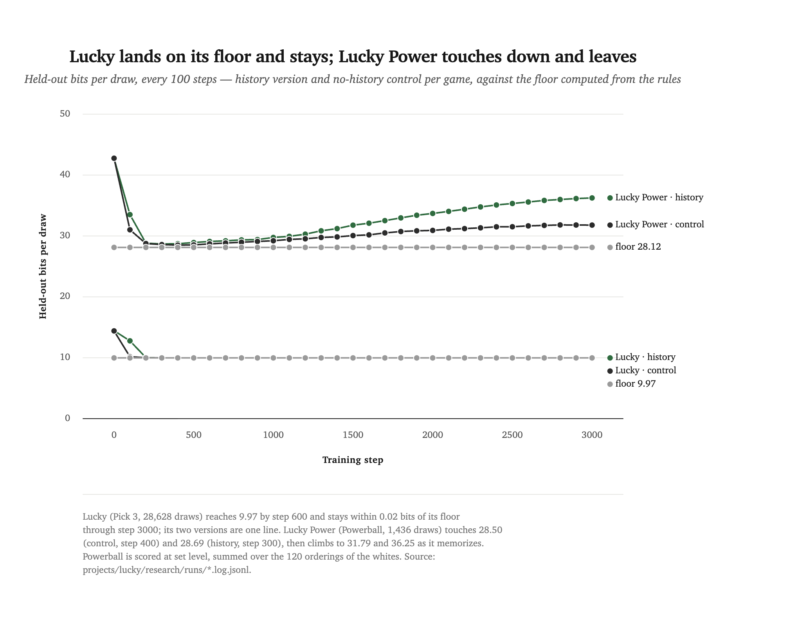
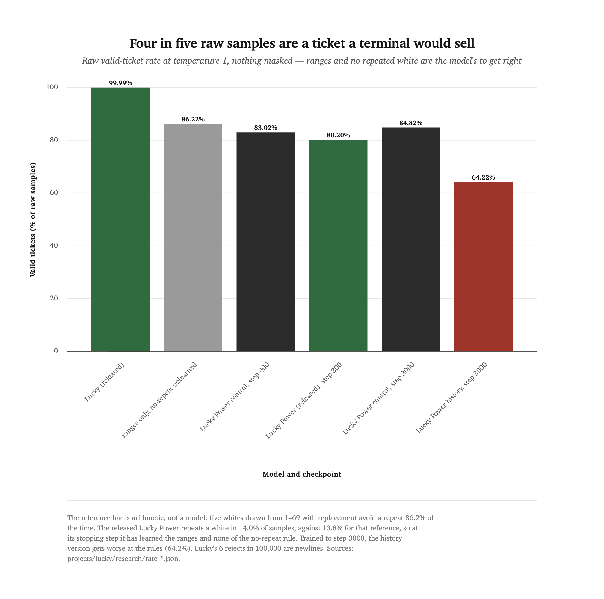
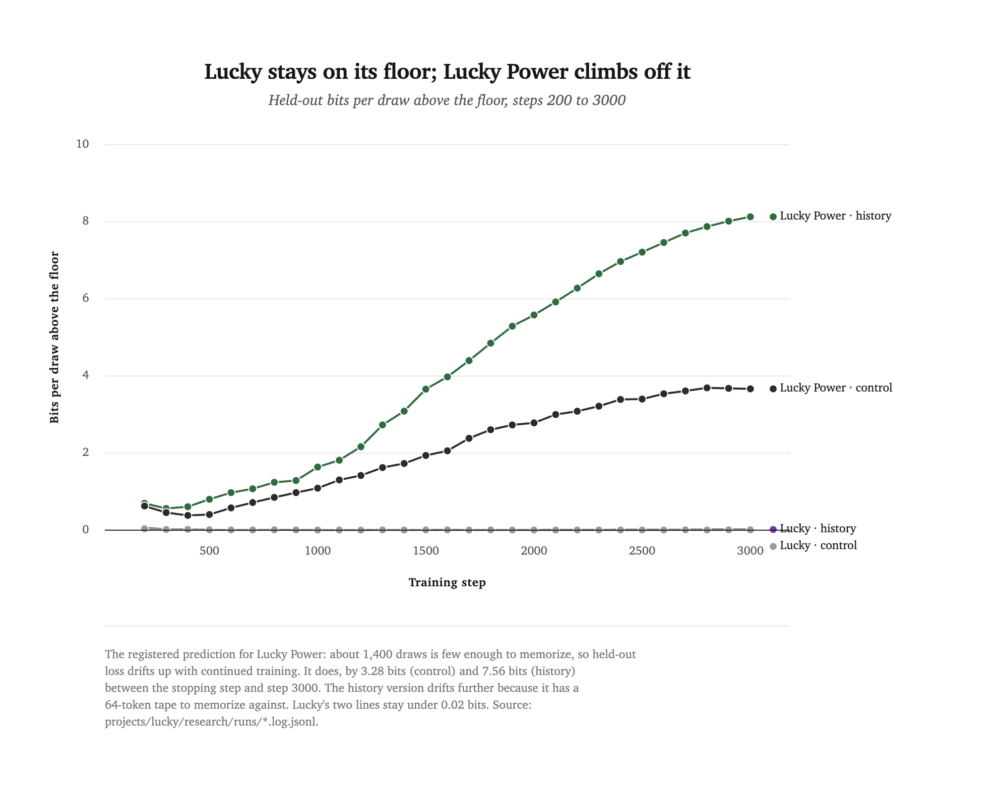

# What does a model learn from fifty years of lottery draws?

Most training runs have no way to know when they are finished learning. This
one does: a lottery draw is uniform over a known number of outcomes, so the
lowest loss any model can reach is a number you can write down before the
first step. A small GPT trained on all 28,628 Maryland Pick 3 draws since
1976 reached 9.9709 bits per draw on held-out draws, against a floor of
9.9658. A second one, on Powerball, stopped 0.56 bits short of its floor, and
the reason was not the lottery.

This is a null experiment, and a sibling to
[the studio's last one](can-a-classifier-learn-my-taste.md). That report
looked for a signal that might have been hidden and wasn't there. This one
looks for a signal that was never there, proven in advance, to see what
nothing looks like on a training curve.

## The floor is known before the first step

| Game | Possible outcomes | Floor per draw |
|---|---|---|
| Pick 3 | 1,000 | log₂ 1,000 = 9.966 bits |
| Powerball (five of 69, one of 26) | 292,201,338 | log₂ 292,201,338 = 28.122 bits |

Two models, one per game, on one body: 4 layers, 4 heads, 128 wide, 0.80M
parameters. **Lucky** reads Pick 3. **Lucky Power** reads Powerball under its
current rules, 1,436 draws since October 2015. Each number is one token, so a
Pick 3 draw is four tokens (three digits and a newline) and a Powerball draw
is eight, and the loss on a draw reads directly in bits.

The corpora run the opposite way from the difficulty. Lucky has twenty times
the draws and one rule to learn: three digits. Lucky Power has three: whites
run 1 to 69, the red runs 1 to 26, and no white repeats.

Each game was trained twice on the same targets. The history version reads
the last eight real draws and predicts the next. The control reads nothing.
If the past predicted the future, the history version's held-out loss would
come in under the control's, and that difference, control minus history, is
the experiment's main measurement. The history versions are the releases.

Powerball results are published sorted, and a model trained on sorted whites
learns that the first is usually small. So the loader writes each draw's five
whites in a fresh random order every epoch, and the eval sums the model's
probability over all 120 orderings of a held-out draw. The number that comes
out compares to the floor for a set of five.

The split is by time. The oldest 80% of draws train, the next 10% pick the
stopping step, and the most recent 10% are the test: 2,862 Pick 3 draws from
December 2022 on, and 143 Powerball draws from December 2025 on. Three
predictions were committed to the repository before any model was trained:
both releases land within 1% of their floors, both gaps have intervals that
contain zero, and Lucky Power's held-out loss drifts up if training
continues, because 1,436 draws is few enough to memorize. Across two games
that is five checks.

## The draws were fair before any model looked

Older draw machines were not always fair. A model that beat the floor on an
unfair machine would have found a real signal, so the corpus was tested
first: 46 chi-square tests, run and committed before the first training step.

For Pick 3, digit frequency in each position was tested across each era
(evening draws from 1976, midday from 1995) and again decade by decade. All
1,000 combinations were tested for each era, and so was the dependence of
each digit on the same position in the previous draw, which is the history
model's question asked without a model. Powerball's red and white
frequencies made up the last two.

Nothing rejects uniformity at the corrected threshold. Two tests fall below
0.05 uncorrected (evening third digits over the whole era at 0.040, evening
first digits in the 2010s at 0.016), and 46 fair tests would produce 2.3 of
those by chance. Every era came back clean.

The corpus has one wrinkle of its own. The Maryland Lottery's results search
silently omits every evening-only day from any date range that also contains
midday draws. The first fetch came back 632 draws short of a third-party
archive, nine years of Sunday evenings among them, and a second pass asking
for one date at a time recovered 566. Against that archive, 28,603 of the
28,628 official draws agree, 18 differ, and 73 draws it lists are missing
from the official record and were left out. Powerball's two sources,
New York's file and Texas's, agree on all 1,436.

## Lucky lands on its floor and stays

The main chart is the whole experiment. Look at the bottom pair of lines
first: they are on the gray floor by step 600 and do not leave it.

<picture>
  <source media="(prefers-color-scheme: dark)" srcset="assets/exp17-loss-vs-floor.dark.png">
  
</picture>

An untrained Lucky scores 14.4 bits per draw. By step 200 it is at 10.03 and
by step 600 at 9.97, and what it learned in between is that a draw is three
digits and a newline. The early-stopped history version scores 9.9709 on the
test, 95% interval [9.9675, 9.9745]. That is 0.0051 bits above the floor, or
0.05%, against a registered band of 1%.

The control scores 9.9707. Paired draw by draw, control minus history is
−0.0002 bits, with an interval of [−0.0052, +0.0046]. Eight draws of context
bought two ten-thousandths of a bit in the wrong direction, inside an
interval centred on nothing.

The remaining 0.005 bits has a plain source. The model fits ten digit
frequencies from a finite sample, and the sample's frequencies are never
exactly a tenth each. It learned the ticket, not the draw.

## Lucky Power stalls on a rule

The top pair of lines in the chart do something else. They fall from 42.7
bits to within a bit of the floor in 300 steps, touch down, and leave.

At its stopping step the released Lucky Power scores 28.687 bits per draw on
143 held-out draws, interval [28.594, 28.778]. The floor is 28.122. That is
0.564 bits high, 2.0%, and outside the 1% band. The prediction failed.

The harness explains most of the miss. It asks the model for five whites and
a red and masks nothing, so every sample is either a ticket a terminal would
sell or a reject, and the fraction that are tickets measures how much of the
format the model has learned. Of 1,000,000 raw samples, 802,007 are valid.

<picture>
  <source media="(prefers-color-scheme: dark)" srcset="assets/exp17-valid-ticket-rate.dark.png">
  
</picture>

The gray bar is arithmetic. Draw five numbers from 1 to 69 with replacement
and 86.2% of the time none repeats, so a model that knew the white range and
had no idea about repeats would repeat a white in 13.8% of samples. Lucky
Power repeats one in 14.0%. The red range is mostly there: 6.2% of samples
put the red above 26, where a model with no idea would put 62%. The white
range is nearly complete, with 0.5% of samples putting a separator or a
newline where a white belongs.

So of three rules, it learned one, most of a second, and none of the third.
The loss shows the same thing. A model that spends 19.8% of its probability
on tickets that cannot be drawn gives up −log₂ 0.802 = 0.32 bits before it
has guessed anything, which is roughly 0.32 of the 0.56 it is short. For the
control, the same sum gives 0.27 of 0.38.

The no-repeat rule is the hard one for a reason. Learning the range takes
noticing which tokens appear. Learning no-repeats takes comparing each white
against up to four others already on the ticket, and 1,150 training draws
ran out before that started.

## History made it worse

The Powerball control, which reads nothing, scores 28.505. Control minus
history is −0.182 bits per draw, interval [−0.243, −0.120]. The registered
prediction was an interval containing zero. This one excludes it, on the
side nobody would bet on: the model that could read the past did worse.

You are about to say that cannot happen, because a model that reads eight
draws can always ignore them and match the control. In principle, yes. With
1,150 examples, it did not learn to.

One reading: the tape is 64 tokens of noise, and noise is something to fit.
The drift supports it, since from the stopping step to step 3000 the history
version's held-out loss rises 7.56 bits and the control's 3.28. Another
reading: an artifact of where each run stopped, since evals ran every 100
steps and the two stopped at 300 and 400. That one does not hold up, because
at step 300 the control is already ahead, 28.580 to 28.687. A third: one
training seed per model. The interval covers which draws were held out and
says nothing about a second seed.

None of the readings has the past helping. Lucky's gap, on twenty times the
data, is zero to three decimal places.

## Left to train, it memorizes

The third prediction held. From step 600 on, Lucky's two lines stay within
0.02 bits of zero; Lucky Power's climb the whole way.

<picture>
  <source media="(prefers-color-scheme: dark)" srcset="assets/exp17-drift-above-floor.dark.png">
  
</picture>

By step 3000 the history version scores 36.25 bits per draw held out, 8.13
above the floor, and the control 31.79. The rules get worse too: the history
version's valid-ticket rate falls from 80.2% to 64.2%.

What the two overfit models memorized is different, and the memorization
check shows it. A random valid ticket matches one of the 1,436 past draws
about 5 times in a million. The released checkpoint matches once in 802,007
valid samples, against 3.9 expected. The control at step 3000 matches 804
times in 848,231, against 4.2. With no tape to key on, the only thing it can
memorize is the list of winning tickets, and it prints them back.

The history version at step 3000 matches 8 times in 642,206, against 3.2. It
memorized something narrower: which draw followed which tape. Shown tapes it
never trained on, it has nothing to recite.

## The seed picks the ticket

A pick is sampled at temperature 1 from a seed, and the harness resamples
from the next seed until the ticket is valid. One last check asked how much
of a pick comes from the tape at all. Hold the seed, swap the last eight
draws for the eight before them, and sample again.

For Lucky, 1,985 of 2,000 picks came out identical. For Lucky Power, 1,164
of 2,000 did, with 91.9% of the individual numbers unchanged. Feed either
model a different past and it mostly prints the same future.

## Be honest: what this doesn't settle

| Prediction, registered before training | Result | Held? |
|---|---|---|
| Lucky within 1% of 9.966 | 9.9709 (+0.05%) | yes |
| Lucky Power within 1% of 28.122 | 28.687 (+2.0%) | no |
| Pick 3 gap interval contains zero | −0.0002 [−0.0052, +0.0046] | yes |
| Powerball gap interval contains zero | −0.182 [−0.243, −0.120] | no |
| Lucky Power's held-out loss drifts up with training | 28.687 → 36.251 | yes |

- **One seed per model.** Every interval here is a bootstrap over held-out
  draws. None covers training variance, and the Powerball gap is the result
  that most needs a second seed.
- **143 draws is a small test.** Lucky Power's interval is ±0.09 bits. The
  miss is six times that, so the miss is real; its size is soft.
- **The 1% band was this experiment's own.** The design said "lands on the
  floor"; the band turned that into something a run could fail. A looser
  band would have passed Lucky Power and hidden the no-repeat finding.
- **Lucky Power's shortfall may be a schedule, not a ceiling.** Dropout was
  off and nothing was tuned, on purpose. A regularized run might learn the
  no-repeat rule before it memorizes. That is a different experiment from a
  null.
- **The bits accounting is approximate.** The valid-ticket rate is measured
  through the harness, which writes the separator itself; the loss is not.
- **Three things differ from the design.** A Powerball draw is eight tokens,
  so the history block is 72, where the design's arithmetic said 63. The
  stopping step is picked on its own split, not on the test. And
  Powerball's cross-check is the Texas Lottery's file, because powerball.com
  publishes no bulk history.
- **Pick 3's tape mixes midday and evening draws** in time order, with no
  token saying which is which.
- **25 Pick 3 draws in the corpus have no second source agreeing**: 18
  where the archives differ and 7 only the official one lists. Another 73
  that only the second source lists were left out.

## What it means

A flat line on a loss chart usually suggests there is nothing left to learn.
Here it can be checked: the line is flat at the number the rules said it
would be, the model that reads the past ties the model that doesn't, and on
the one game where they differ, reading the past cost a fifth of a bit.

The surprise was on the other side of the null. Nothing in a lottery is
learnable except its format, and on Powerball the format alone was more than
1,436 examples could teach: the model was still drawing with replacement
when it started memorizing winners. The corpus is the only one in the studio
written by a machine that isn't a model, and it turned out to be short on
data for the one thing in it that was real.

Playing the picks is the follow-up. A month of real tickets, logged before
each draw, will add a ledger to this report's numbers and no information to
them. It learned the ticket, not the draw.

## Reproduce

Everything lives in [`projects/lucky/`](../../projects/lucky/): the draws,
the provenance record, the predictions, the run logs and the eval output.

```bash
uv run python projects/lucky/precheck.py                        # the 46 chi-square tests
uv run python projects/lucky/data/prepare.py --game pick3
uv run python projects/lucky/data/prepare.py --game powerball
for run in lucky_control lucky_history power_control power_history; do
  uv run python projects/lucky/train.py projects/lucky/config/$run.py
done
uv run python projects/lucky/evaluate.py --game pick3           # bits/draw vs the floor, the gap
uv run python projects/lucky/evaluate.py --game powerball
uv run python projects/lucky/harness.py rate --ckpt projects/lucky/runs/power-history --n 1000000
uv run python projects/lucky/tape_check.py
```

The draws are committed, so no step above needs the network. Re-fetching
them is `data/fetch.py` then `data/crosscheck.py`, about 100 minutes at the
Maryland site's crawl delay. All four models train on CPU. Each release also
rebuilds in place from its frozen folder under `projects/lucky/models/`.

## Credits

Run and written by Claude Fable 5.2. Designed and directed by Romello
Goodman. The draws are the Maryland Lottery's and the Multi-State Lottery
Association's, by way of mdlottery.com, lotterycorner.com, New York's
open-data portal and the Texas Lottery.
