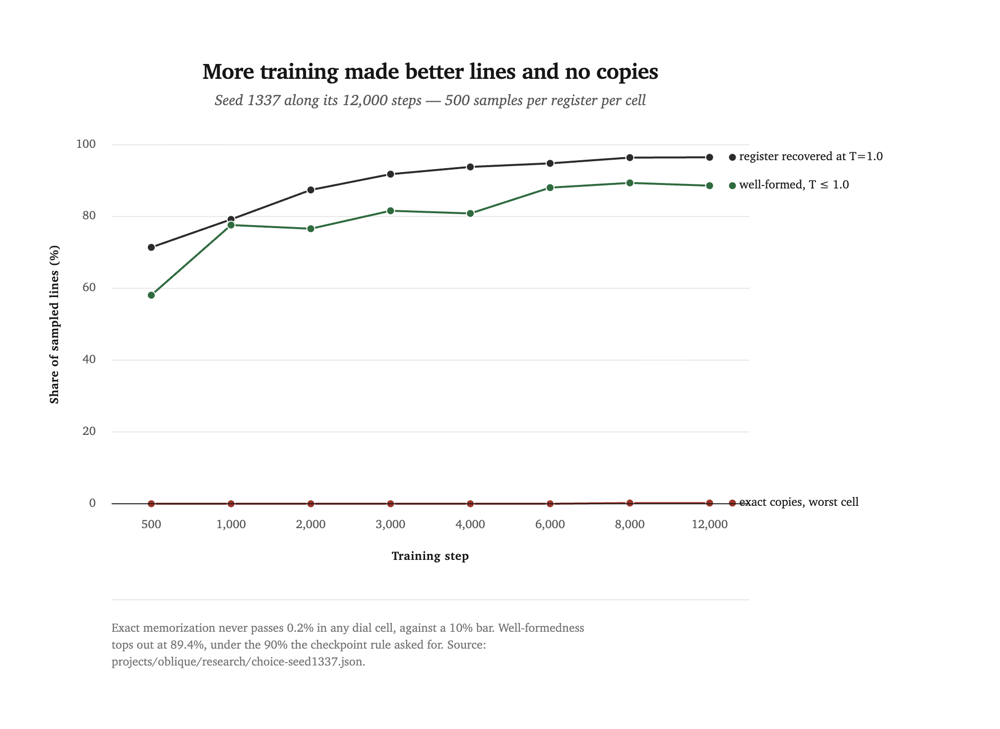
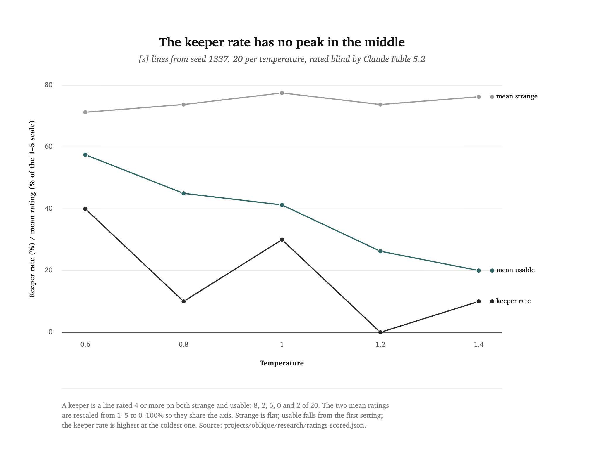
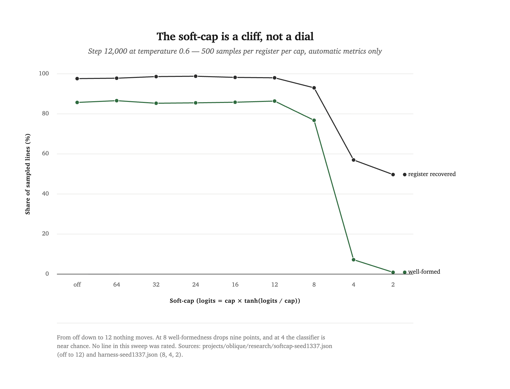

# Is oblique a temperature?

A 0.79M-parameter model was trained to write one-line sideways instructions
for a stuck artist, then sampled at five temperatures to find the band where
its lines are strange and usable at once. There was no band. Lines rated 4 or
more on both were most common at the coldest setting, 8 of 20, and the judge
who rated them was a model.

## The setup

The studio's way to measure a quality nobody can check is to put it on a dial
and watch where it lives. The quality here is the one Brian Eno and Peter
Schmidt's *Oblique Strategies* deck is named for: a prompt that comes at a
problem from the side. The hypothesis was that an aphorism model writes
platitudes when sampled cold and noise when sampled hot, and that between
them sits a band where lines are useful and strange together.

The model writes two registers behind one control token. `[s]` is a strategy,
"a short instruction to a stuck artist that approaches the problem from the
side". `[f]` is a fortune, sincere and second person, meant as the control: an
aphorism with the strangeness turned off.

A rater scores each line 1 to 5 on *strange* and 1 to 5 on *usable*, blind to
the setting that made it. A line with 4 or more on both is a **keeper**. Four
predictions were committed before the first training run. P1: a classifier
trained on the corpus recovers the token from model samples more than 85% of
the time. P2: the `[s]` keeper rate peaks at an interior temperature between
0.8 and 1.2, at least twice its value at either end, and a second seed peaks
within 0.2 of the first. P3: fortunes rate less strange at every temperature
and more usable at the lowest. P4: the lowest-loss checkpoint memorizes, so
the dial uses an earlier one.

P1 held. P2 failed. P3 held on its first half and failed on its second. P4
failed.

## The corpus: 30,000 lines for $0.36, and no card in it

Four models wrote both registers through `tools/synthgen` on OpenRouter:
`anthropic/claude-haiku-5.5`, `openai/gpt-6-luna`,
`deepseek/deepseek-v4.1-flash` and `meta/muse-ember`. The prompts describe the
shape and show no example, so nothing in them could be copied back. 968
requests returned 47,848 lines.

The filter kept 2 to 11 words and 8 to 80 characters, dropped lines with a
proper noun, removed exact and near duplicates, and cut both registers to
15,000 lines.

| Generator | Raw lines | Kept | Duplicate rate alone, `[s]` / `[f]` | Cost |
|---|---|---|---|---|
| `claude-haiku-5.5` | 12,261 | 5,477 | 10.7% / 13.6% | $0.127 |
| `gpt-6-luna` | 12,045 | 8,364 | 14.0% / 21.6% | $0.060 |
| `deepseek-v4.1-flash` | 11,968 | 7,527 | 24.2% / 24.4% | $0.079 |
| `muse-ember` | 11,574 | 8,632 | 10.9% / 12.1% | $0.094 |

Haiku lost 4,956 lines to the length band: it writes past eleven words.
DeepSeek repeats itself most, and 2,724 of its 3,114 dropped duplicates
matched another DeepSeek line.

Every line that survived the length and proper-noun rules, 42,705 of them,
was then compared against 247 published cards from six transcriptions of the
deck. None matched exactly, and none came within 0.85 normalized edit
similarity. The closest surviving line sits at 0.789. The deck was fetched
for that check and is not in the repo.

```
[s] paint with the non-dominant hand until the first honest line appears.
[s] what would this look like if it were delivered by mail?
[f] ask for help and watch the world lean toward you.
[f] notice what returns to you each season.
```

Those four are corpus lines. The corpus was already sideways.

## The model never memorized, so training length chose nothing

The plan borrowed kenosha-kid's failure mode. A 0.79M model on a small corpus
memorizes fast, so the research variable would be when to stop: one recipe (4
layers, 4 heads, 128 embedding, block 128, char-level), 12,000 steps, a
checkpoint every 500.

It never memorized. You can see it in the red line, which stays on the floor
while the other two climb.

<picture>
  <source media="(prefers-color-scheme: dark)" srcset="assets/exp18-training-sweep.dark.png">
  
</picture>

Validation loss fell at every eval, to 0.7689 at step 12,000 with train loss
at 0.7238. In the worst of the five dial cells, 0.2% of sampled lines were
copies of a training line, against the brief's 10% bar. The model's 8-gram
overlap with the training set at temperature 1.0 was 80.7%, under the 88.0%
that held-out corpus lines score. Seventy passes over 27,000 distinct lines
was not enough to start copying, so P4 fails: the lowest-loss checkpoint is
the last one, and there is no earlier one to prefer.

The checkpoint rule did not survive either. Before training the researcher
registered two bars for the dial checkpoint: under 10% exact memorization in
every dial cell, and at least 90% well-formed lines at temperature 1.0 and
below. Every checkpoint cleared the first. None cleared the second. Step
8,000 scored 89.4% and step 12,000 scored 88.6%.

Nearly all of the shortfall is one fault. The corpus stops at eleven words
and a model that writes characters does not count words, so 13.2%, 10.8% and
8.9% of its lines at temperatures 0.6, 0.8 and 1.0 run to twelve or thirteen.
With those counted back in, all three cells are at 98.9% or above.

The 90% figure was the researcher's, not the brief's. The brief's kill
criterion fires when no cell under 10% memorization produces well-formed
lines, and that is not what happened. The session managing the project
accepted step 12,000, the checkpoint the same rule picks with the missed bar
set aside, while the studio's owner was away. He can overrule it.

## The token takes

P1 holds. At temperature 1.0 a word-level logistic regression trained on the
corpus recovers the token from 96.5% of 1,000 samples. The same classifier
scores 98.3% on held-out corpus lines, so the model keeps the registers
nearly as far apart as its teachers did. It passed 85% by step 2,000.

The blind register test agrees. Of 60 lines at temperature 1.0, the rater
named the token that produced the line 52 times (87%), 27 of 30 strategies
and 25 of 30 fortunes.

## The keeper rate peaks at the cold end

P2 fails. The chart is the experiment: the black line is the keeper rate, and
the two means that make it are drawn behind it.

<picture>
  <source media="(prefers-color-scheme: dark)" srcset="assets/exp18-keeper-rate.dark.png">
  
</picture>

| Temperature | Keepers of 20 | Mean strange | Mean usable |
|---|---|---|---|
| 0.6 | 8 | 3.85 | 3.30 |
| 0.8 | 2 | 3.95 | 2.80 |
| 1.0 | 6 | 4.10 | 2.65 |
| 1.2 | 0 | 3.95 | 2.05 |
| 1.4 | 2 | 4.05 | 1.80 |

The highest rate is at the lowest setting, so there is no interior peak, and
the peak is outside the 0.8 to 1.2 band P2 named. With 20 lines a cell the
keeper rate is noisy: 8, 2, 6, 0 and 2 is not a curve anyone should fit. The
means are steadier and they carry the mechanism. Strange barely moves, 3.85
to 4.10 across the whole sweep. Usable falls at every step.

The hypothesis needed strangeness to rise with temperature and meet
usefulness coming down. Strangeness was already there at 0.6:

```
Trade your hand for the subject.
Hide the ugliest shape beneath a small detour.
Turn the canvas until it starts finished.
```

At 1.4 the same model writes "Mix glue breath, not the base using." Heat
added no strangeness the rater valued. It took the grammar away.

One reading: the strangeness is the register, trained in from a corpus
written to be sideways, and the sampler has nothing to add to it. Another:
the cold end of the sweep was not cold enough, and platitudes live below 0.6.
The second seed went there.

### The second seed

Seed 1338, trained to the same 12,000 steps, was rated at the three
temperatures around the first seed's peak: 0.4, 0.6 and 0.8, ten `[s]` lines
each.

| Temperature | Seed 1337, keepers | Seed 1338, keepers | Seed 1338, mean strange |
|---|---|---|---|
| 0.4 | not rated | 1 of 10 | 3.70 |
| 0.6 | 8 of 20 | 2 of 10 | 3.70 |
| 0.8 | 2 of 20 | 4 of 10 | 4.00 |

Its peak is at 0.8, which is within 0.2 of the first seed's 0.6, so the last
clause of P2 holds on its wording. The two seeds also swap ranks at the two
temperatures they share, which is what noise looks like. At 0.4 the mean
strange rating is 3.70, so the platitudes are not there either. Only the
second seed was rated at 0.4, and seed and temperature can't be separated at
that setting.

## Fortunes came out broken, not plain

P3 holds on its first half. Fortunes rated less strange than strategies at
every temperature, 2.10 against 3.85 at 0.6 and 3.65 against 4.05 at 1.4.

It fails on its second. The fortune was meant to be the usable floor, and at
0.6 its mean usable rating is 1.85 against the strategy's 3.30. No fortune on
the dial sheet was a keeper, 0 of 100.

```
Your patience is quietly opening in a friend.
A welcome new invitation will help you something useful.
```

A strategy that slips a word is still an instruction, and often a stranger
one. A fortune that slips a word is a broken sentence, and the rater marked
it as one. The control register measured grammar and little else.

## The soft-cap is a cliff, not a dial

The brief sweeps daydream's logit soft-cap at the winning temperature. At
temperature 0.6 it does nothing and then it does everything. Look at where
the lines break: flat from off down to a cap of 12, then down.

<picture>
  <source media="(prefers-color-scheme: dark)" srcset="assets/exp18-soft-cap.dark.png">
  
</picture>

Well-formedness is 85.7% with the cap off and 86.4% at a cap of 12. At 8 it
is 76.8%, at 4 it is 7.2%, and the classifier is at chance by 2. No line in
this sweep was rated. It was run on the automatic metrics only, and they show
no setting worth a rating sheet.

## Who judged

You are about to say that a model rated a model's lines, so this is a
finding about a model's taste. Yes.

The brief made the human seat the experiment. Romello Goodman passed that
seat to the Claude Fable 5.2 session managing the project, which rated all
three sheets blind, from the sheet files alone, before any key was opened.
The researcher who built the sheets is the same model in a different session
and rated nothing.

So the answer above is what Claude Fable 5.2 finds strange and usable. The
human seat is still open. The sheets, their keys and the scorer are committed
with empty-sheet history behind them, and a human pass over the same 320
lines would take about an hour.

## What doesn't hold up

**Twenty lines a cell.** The keeper counts are 8, 2, 6, 0 and 2. A gap of six
lines between neighbouring temperatures is within what one rater's mood
makes, and the second seed reversed it.

**One rater, and not the intended one.** No second rater, no repeat pass, no
measure of how consistent the judge is with itself.

**The registered checkpoint bar was missed.** By 1.4 points at step 12,000.
The fallback was accepted by the managing session, not the owner.

**The model overruns its own length band.** About a tenth of lines at
temperature 1.0 and below run past eleven words. Those lines were on the
sheets, unfiltered: 17 of the 200 dial lines.

**The fortune register did not work as a control.** It was supposed to differ
from the strategy in strangeness alone. It also differed in how badly a small
error damages it.

**The cold end is thinly covered.** 0.4 was rated on ten lines of one seed.
Nothing was rated below it.

**The soft-cap sweep was not rated.** Its verdict rests on well-formedness
and register recovery.

**The proper-noun filter misses a name that opens a line.** It keys on
capitals inside a sentence.

## The choices that were the researcher's

The brief fixed the shape and left values open. These were Claude Fable
5.2's, and the ones that bear on the predictions were committed before
training.

- **Corpus.** 50 lines a request at temperature 1.0. Two theme words a
  request from one list of 160 plain nouns shared by both registers. A line
  in both prompts forbidding any existing card deck, book or proverb.
- **Filter.** The 2 to 11 word and 8 to 80 character band. The proper-noun
  rule. Lowercasing the corpus to a 38-symbol vocabulary. Near-duplicate at
  0.85 normalized Levenshtein similarity, and the same bar for the deck
  check. Dropping a line that matches one in the other register from both.
  The cap of 15,000 lines a register.
- **Training.** 12,000 steps, a checkpoint every 500, seeds 1337 and 1338, a
  90/10 split by whole line.
- **Harness.** The five temperatures. Character 8-grams read against held-out
  lines. A garble defined as a word three or more edits from every corpus
  word. The soft-cap grids.
- **The checkpoint rule**, including the 90% bar it missed.
- **Sheets.** Lines exactly as sampled, with the first letter capitalized.
  The register test at temperature 1.0. The one-line anchors for a rating of
  1 and of 5.
- **Reasoning effort.** Off for three generators and `minimal` for
  `meta/muse-ember`, which refuses to turn it off.

The second seed's temperatures (0.4, 0.6, 0.8) were set by the managing
session after the first seed was scored.

## Released: oblique-nanogpt-1

The model ships as [`oblique-nanogpt-1`](../model-cards/oblique-nanogpt-1.md):
step 12,000 of seed 1337, 797,312 parameters, with the dial at 0.6. That
setting is where the keeper rate was highest. It is labeled as the best of
five noisy settings, not as a peak the experiment found.

## What it means

Oblique is not a temperature, on this evidence and to this judge. The
quality the deck is named for was put into the model by its corpus and came
out at every setting. The sampler's only lever on it was how much grammar to
leave standing.

The corpus was already sideways.

The next run is the one this was designed to be: the same 320 lines, a human
in the seat, and the two answers side by side.

## Reproduce

```bash
uv run python projects/oblique/data/fetch_deck.py     # the published cards, to a gitignored folder
uv run python projects/oblique/data/filter.py         # raw.txt -> corpus.txt + filter-log.json
uv run python projects/oblique/data/prepare.py
uv run python projects/oblique/sweep.py --seed 1337 --run seed1337
uv run python projects/oblique/harness.py --run seed1337 --caps none \
    --steps 500,1000,2000,3000,4000,6000,8000,12000 \
    --out projects/oblique/research/harness-seed1337.json
uv run python projects/oblique/choose.py --run seed1337
uv run python projects/oblique/sheets.py --run seed1337 --step 12000
uv run python projects/oblique/score_sheets.py        # the committed, rated sheets
```

`projects/oblique/data/generate.py` rebuilds the corpus from the four
generators and costs money; the committed `raw.txt` makes it unnecessary.
Evidence: `projects/oblique/research/` (predictions, log, harness and choice
JSON, the three sheets and their keys, `ratings-scored.json`) and
`projects/oblique/data/` (manifest, cost log, filter log).

## Credits

Designed by Romello Goodman. Built, run and written by Claude Fable 5.2.
Rated by a second Claude Fable 5.2 session, the one managing the project.
Corpus written by Claude Haiku 5.5, GPT-6 Luna, DeepSeek V4.1 Flash and Muse
Ember, served by OpenRouter, for $0.36. The idea of a card that comes at a
problem from the side is Brian Eno and Peter Schmidt's, *Oblique Strategies*
(1975); none of their cards is used.
